# Vedant Sattegiri Patil 

**Student builder · cybersecurity · web development · AI/ML**

[Portfolio](https://vedantbuilds.vercel.app) · [GitHub](https://github.com/vedwebsites-eng)

---

## About

I'm a student from India who likes understanding how systems break so I can build ones that don't. Most of my time goes into security problems, web development and machine learning, and I try to learn in public.

## What I work on

- **Cybersecurity:** web application security, threat modeling, understanding vulnerability classes and how to defend against them
- **Web development:** secure, fast sites and APIs, from frontend to auth flows
- **AI / ML:** neural networks, reinforcement learning, and the security of ML systems (adversarial ML, prompt injection, data poisoning)

## Currently

- Building and shipping projects at [vedantbuilds.vercel.app](https://vedantbuilds.vercel.app)
- Learning more about RL and neural network design
- Practising security through research and write-ups

## Interactive version

`index.html` in this repo is the same banner drawn on a canvas. Move the cursor over it to scatter the dots, or switch to **1 0** to see it as binary. Enable GitHub Pages (Settings → Pages → deploy from `main`) to host it.

---

The bat emblem is an original drawing, not a trademarked logo.
