<div align="center">


# Vedant Sattegiri Patil

**I study how systems break, so I can build ones that don't.**


[Portfolio](https://vedantbuilds.vercel.app) · [GitHub](https://github.com/vedwebsites-eng)

<br>



</div>

---

## What I do

| 🛡️ Break it | 🌐 Build it | 🧠 Teach it |
|---|---|---|
| Web app security, threat modeling and the vulnerability classes behind real breaches. I study attacks so I can defend against them. | Fast, secure sites and APIs, from the frontend to auth flows. | Neural networks and reinforcement learning, plus the security of ML itself: adversarial ML, prompt injection, data poisoning. |

## Projects

<table>
<tr>
<td width="50%" valign="top">

### [AETHOSGAMMA](https://github.com/vedwebsites-eng/AETHOSGAMMA)
*Live life GAMIFIED.*

A self-improvement habit tracker for students and individuals.

`TypeScript` `Vite` `Firebase`

[**View repo →**](https://github.com/vedwebsites-eng/AETHOSGAMMA)

</td>
<td width="50%" valign="top">

### [INKWELL](https://github.com/vedwebsites-eng/INKWELL)
*Make DOCUMENTARIES better.*

A no-distraction code editor for better documentaries and case studies.

`TypeScript` `Vite` `Firebase` `Gemini API`

[**View repo →**](https://github.com/vedwebsites-eng/INKWELL)

</td>
</tr>
</table>

## Currently

- ▸ Building and shipping projects at [vedantbuilds.vercel.app](https://vedantbuilds.vercel.app)
- ▸ Going deeper on RL and neural network design
- ▸ Practising security through research and write-ups

<details>
<summary><b>🧩 A little challenge for the curious</b></summary>

<br>

Security people leave breadcrumbs. This one is two layers deep:

```
01011010 01101101 01111000 01101000 01011010 00110011
01110100 01101101 01011001 01010111 01111000 01110011
01011000 00110010 01111000 01101100 01011001 01011000
01001010 01110101 01011000 00110011 01001010 01110000
01100011 00110010 01010110 00111001
```

**Hint:** the binary isn't the answer, it's the wrapper. What comes out has a familiar shape, and it's about the banner above.

Cracked it? Say hi through my [portfolio](https://vedantbuilds.vercel.app).

</details>

<div align="center">

*Fall. Learn. Rise. Repeat.*

<sub>The bat emblem is an original drawing, not a trademarked logo.</sub>

</div>
